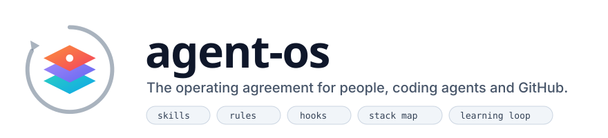
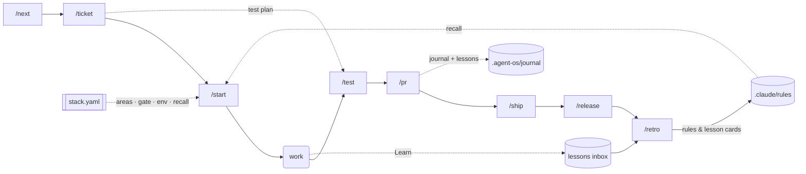

<p align="center">
  
</p>

<p align="center">
  <a href="https://github.com/cosmin-sisman/agent-os/milestones"></a>
  <a href="LICENSE"></a>
  
  
  
  <a href="CONTRIBUTING.md"></a>
</p>

<p align="center">
  <a href="#-quick-start">Quick start</a> ·
  <a href="#-what-you-get">Features</a> ·
  <a href="#-how-it-works">How it works</a> ·
  <a href="https://cosmin-sisman.github.io/agent-os/">Stack map &amp; artifacts</a> ·
  <a href="docs/design/overview.md">Design</a> ·
  <a href="#-roadmap">Roadmap</a> ·
  <a href="#-community">Community</a>
</p>

---

**agent-os** installs a working agreement into any repository. It sets up the skills, rules, hooks and small deterministic scripts that let a team (five people or fifty, each with their own coding-agent sessions on their own laptops) move work from idea to production the same way every time. GitHub is the shared memory. Every piece of work also teaches the system something, so it keeps up with the project instead of falling behind it.

```bash
npx @cosmin-sisman/agent-os init
```

> [!NOTE]
> **agent-os is in its design phase.** The design, decisions and plan are public and open for discussion. The package is built in the open, milestone by milestone. Watch the repository or pick an issue labelled [`good first issue`](https://github.com/cosmin-sisman/agent-os/labels/good%20first%20issue).

## ✨ What you get

<table>
<tr>
<td width="50%" valign="top">

### 🧭 One flow, every repository
`/next` → `/ticket` → `/start` → work → `/test` → `/pr` → `/ship` → `/release`. The same path in an empty repo, a spec-only repo, a codebase in full swing or a product in maintenance.

</td>
<td width="50%" valign="top">

### 🔁 A learning loop with no exceptions
Every skill ends with a *Learn* step and every PR carries its lessons. Lessons come back automatically when someone works in the same area. A required CI check keeps the loop honest.

</td>
</tr>
<tr>
<td valign="top">

### 🧱 Stack map
A bilingual catalog of 24 layers, 126 technologies, languages and providers, plus reference stacks from level 1 to 5. One readable `stack.yaml` drives labels, tests, environment checks and lessons.

</td>
<td valign="top">

### 👥 Built for teams
GitHub issues, sub-issues, dependencies, assignees and comments are the coordination layer. Nothing personal is committed, local hooks only remind, and CI enforces.

</td>
</tr>
<tr>
<td valign="top">

### 🗂️ Conflict-free knowledge
A journal of small files where every PR brings its own entry, decision records with date ids, and lesson cards with a lifecycle. Maps and indexes are generated on demand and never committed.

</td>
<td valign="top">

### 🧩 Core, external and local skills
A registry keeps agent-os's own skills apart from third-party and project-made ones. Capability slots let you swap a design or review skill with one line.

</td>
</tr>
<tr>
<td valign="top">

### 🖼️ Artifacts in the repo
Discovery reports, analyses and maps as pages that are versioned in git, published to GitHub Pages, verified against their sources and linked from issues and PRs.

</td>
<td valign="top">

### 🛡️ Safe updates
A pinned version per project, `new → stable → deprecated → legacy → removed` markers on everything shipped, and upgrades as a reviewable PR with migrations.

</td>
</tr>
<tr>
<td valign="top">

### 🌍 Your languages, per area
Issues, PRs, commits, labels, milestones, docs and chat are each set to `en` or `ro` (Romanian without diacritics), in any combination.

</td>
<td valign="top">

### 🔌 Environment check
`/env` verifies MCP servers, CLIs, GitHub token scopes and variables on your laptop and in the repo, and prints the exact command that fixes each gap.

</td>
</tr>
</table>

## 🚀 Quick start

> These commands describe the target CLI. Track progress in the [v0.1 milestone](https://github.com/cosmin-sisman/agent-os/milestone/1).

```bash
npx @cosmin-sisman/agent-os init      # detects the repo's state, asks 4–6 questions, shows the plan, then writes it
npx @cosmin-sisman/agent-os doctor    # checks the agent system and GitHub hygiene (the same check runs in CI)
npx @cosmin-sisman/agent-os next      # what to work on next, and why
```

`init` recognizes four kinds of repository and adapts:

| Your repository | Profile | What agent-os adds first |
|---|---|---|
| Empty | `greenfield` | `/kickoff`: a product interview, then docs, milestones and the first issues |
| Specs and docs, little code | `spec-first` | `/ingest-docs`: specifications become epics and sub-issues linked to their sources |
| In active development | `active` | `/discover`: conventions inferred from history; **retrofit** or **forward-only** adoption |
| Finished, in maintenance | `maintenance` | `/audit`, `/runbook`, `/handoff` |

## 🧠 How it works



| Layer | Holds | Where |
|---|---|---|
| **Facts** | what is true now | `AGENTS.md` (short), `docs/`, `stack.yaml` |
| **Policy** | rules, each with its reason | `.claude/rules/` |
| **Procedure** | step-by-step workflows | `.claude/skills/` |
| **Determinism** | every mechanical step, with `--dry-run` and `--json` | the `agent-os` CLI |
| **Enforcement** | what must hold even when nobody remembers | hooks (local), required checks (CI) |
| **History** | decisions, lessons, incidents, releases, handoffs | `.agent-os/journal/`, GitHub |

Read the full [design overview](docs/design/overview.md) and the [decision records](docs/decisions/README.md).

## 🧱 Stack map

<p>
  <a href="https://cosmin-sisman.github.io/agent-os/2026-11-18-stack-map/"><b>Open the interactive stack map →</b></a>
</p>

The [catalog](catalog/) is plain YAML anyone can read in a PR. It holds layers, technologies with `complexity` and `aiFriendly` scores, languages, providers with `cost`, `euRegions` and an `mcpHint`, runtimes, and [ten blueprints](catalog/blueprints.yaml). A project describes itself in one [`stack.yaml`](examples/stack.yaml):

```yaml
layers:
  internal-api:
    tech: hono-trpc
    provider: railway
    status: chosen
    paths: ["apps/api/src/routers/**"]
  data-layer:
    tech: drizzle-supabase-postgres
    status: chosen
    paths: ["packages/db/**", "supabase/migrations/**"]
```

## 🗺️ Roadmap

| Milestone | Theme |
|---|---|
| [v0.1 Foundations](https://github.com/cosmin-sisman/agent-os/milestone/1) | CLI, config, templates, lock, languages, hooks runner, environment check, pinned versions and migrations |
| [v0.2 Core workflow](https://github.com/cosmin-sisman/agent-os/milestone/2) | GitHub setup, tracker adapter, `/ticket` `/start` `/pr` `/ship` `/release` `/next`, safe `update` |
| [v0.3 Knowledge and loop](https://github.com/cosmin-sisman/agent-os/milestone/3) | journal, lessons with recall, chronicle, `map`, `/retro`, `doctor`, the required loop check, `/upstream` |
| [v0.4 Collaboration](https://github.com/cosmin-sisman/agent-os/milestone/4) | claim protocol, overlap detection, comment-driven work, optional orchestrator, `/handoff` |
| [v0.5 Skill registry](https://github.com/cosmin-sisman/agent-os/milestone/5) | core / external / local registry, capability slots |
| [v0.6 Testing and CI](https://github.com/cosmin-sisman/agent-os/milestone/6) | `/test`, one gate locally and in CI, `/gh-actions` |
| [v0.7 Init and adoption](https://github.com/cosmin-sisman/agent-os/milestone/7) | detection, profiles, retrofit and forward-only, `/discover`, `/kickoff`, packs |
| [v0.8 Stack map and artifacts](https://github.com/cosmin-sisman/agent-os/milestone/9) | `stack.yaml`, `/stack`, catalog overlays, `/artifact`, Pages |
| [v1.0 Release](https://github.com/cosmin-sisman/agent-os/milestone/8) | Claude Code plugin, npm with provenance, skill evals, docs, dogfooding |

## 🤝 Community

agent-os gets better from the projects that use it.

- 💬 **Ideas and questions:** [Discussions](https://github.com/cosmin-sisman/agent-os/discussions)
- 🐛 **Bugs and features:** [open an issue](https://github.com/cosmin-sisman/agent-os/issues/new/choose). From inside a project, `/upstream` drafts one for you with private details removed.
- 🛠️ **Contribute:** read [CONTRIBUTING.md](CONTRIBUTING.md) and pick a [`good first issue`](https://github.com/cosmin-sisman/agent-os/labels/good%20first%20issue)
- 🔒 **Security:** see [SECURITY.md](SECURITY.md); please don't open public issues for vulnerabilities
- 🌱 **Be kind:** we follow our [Code of Conduct](CODE_OF_CONDUCT.md)

## 📄 License

[MIT](LICENSE) © Cosmin Sisman and contributors.

<p align="center"><sub>Built with people and agents, one lesson at a time.</sub></p>
