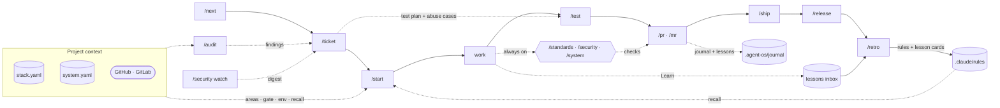

<p align="center">
  
</p>

<p align="center">
  <a href="https://www.npmjs.com/package/@cosmin-sisman/agent-os"></a>
  <a href="LICENSE"></a>
  
  <a href="https://github.com/cosmin-sisman/agent-os/actions/workflows/ci.yml"></a>
  
  
  
  <a href="CONTRIBUTING.md"></a>
</p>

<p align="center">
  <a href="#-quick-start">Quick start</a> ·
  <a href="docs/guides/usage.md"><b>Usage guide</b></a> ·
  <a href="#-what-you-get">Features</a> ·
  <a href="#-how-it-works">How it works</a> ·
  <a href="docs/guides/README.md">Guides</a> ·
  <a href="docs/reference/commands.md">Commands</a> ·
  <a href="https://cosmin-sisman.github.io/agent-os/">Stack map &amp; artifacts</a> ·
  <a href="docs/design/overview.md">Design</a> ·
  <a href="#-roadmap">Roadmap</a> ·
  <a href="#-community">Community</a>
</p>

---

**agent-os** installs a working agreement into any repository. It sets up the skills, rules, hooks and small deterministic scripts that let a team (five people or fifty, each with their own coding-agent sessions on their own laptops) move work from idea to production the same way every time. Your code platform is the shared memory: **GitHub or GitLab**, in the cloud or self-managed on your own servers. Every piece of work also teaches the system something, so it keeps up with the project instead of falling behind it.

```bash
npx -y @cosmin-sisman/agent-os install
```

> [!TIP]
> **New here?** Follow the [Quick start](#-quick-start) to install it, then the [usage guide](docs/guides/usage.md): the daily loop, every skill with an example prompt and a real sample of its output, use cases and troubleshooting.

## ✨ What you get

<table>
<tr>
<td width="50%" valign="top">

### 🧭 One flow, every repository
`/next` → `/ticket` → `/start` → work → `/test` → `/pr` → `/ship` → `/release`. The same path in an empty repo, a spec-only repo, a codebase in full swing or a product in maintenance.

</td>
<td width="50%" valign="top">

### 🔁 A learning loop with no exceptions
Every skill ends with a *Learn* step and every PR carries its lessons. Lessons come back automatically when someone works in the same area. A required CI check keeps the loop honest.

</td>
</tr>
<tr>
<td valign="top">

### 🧱 Stack map
A bilingual catalog of 24 layers, 127 technologies, languages and providers, plus reference stacks from level 1 to 5. One readable `stack.yaml` drives labels, tests, environment checks and lessons.

</td>
<td valign="top">

### 👥 Built for teams
Issues, sub-issues or epics, dependencies, assignees and comments on your platform are the coordination layer. Nothing personal is committed, local hooks only remind, and CI enforces.

</td>
</tr>
<tr>
<td valign="top">

### 🗂️ Conflict-free knowledge
A journal of small files where every PR brings its own entry, decision records with date ids, and lesson cards with a lifecycle. Maps and indexes are generated on demand and never committed.

</td>
<td valign="top">

### 🧩 Core, external and local skills
A registry keeps agent-os's own skills apart from third-party and project-made ones. Capability slots let you swap a design or review skill with one line.

</td>
</tr>
<tr>
<td valign="top">

### 🖼️ Artifacts in the repo
Discovery reports, analyses and maps as pages that are versioned in git, published to GitHub Pages, verified against their sources and linked from issues and PRs.

</td>
<td valign="top">

### 🛡️ Safe updates
A pinned version per project, `new → stable → deprecated → legacy → removed` markers on everything shipped, and upgrades as a reviewable PR with migrations.

</td>
</tr>
<tr>
<td valign="top">

### 🦊 GitHub or GitLab, cloud or on-premise
Choose your platform at `init`: github.com, GitHub Enterprise Server, gitlab.com, or GitLab self-managed or Dedicated. agent-os probes what your instance and tier support, installs only that platform's files (`.github/` or `.gitlab/`), speaks its vocabulary (`/pr` and `#N`, or `/mr` and `!N`) and falls back gracefully where a feature is missing.

</td>
<td valign="top">

### 🧪 Testing and CI built in
One gate definition runs locally and in CI. `/test` plans scenarios at ticket time and reports results at review time, and `/ci` writes GitHub Actions or GitLab CI pipelines by best practice.

</td>
</tr>
<tr>
<td valign="top">

### 🔍 Audit anything
`/audit` takes an idea, specs, a project at any stage, a release, a specific problem or a whole system. It looks through separate lenses (product, architecture, stack, code, security, cost, delivery, process, operations), backs every finding with evidence, and turns the findings into an artifact plus issues.

</td>
<td valign="top">

### 🛡️ Security that keeps watch
`agent-os security` follows the advisories that affect *your* dependencies and stack (GHSA, OSV, NVD, CISA KEV, vendors). It checks every change request by layer, writes threat models and abuse cases, and reports vulnerabilities only through private channels.

</td>
</tr>
<tr>
<td valign="top">

### 🕸️ System map
Single app, monorepo or microservices across repositories. `/system` maps components, how they talk (REST, GraphQL, gRPC, events, webhooks) and what is public or internal. It inventories endpoints, keeps OpenAPI and AsyncAPI in sync, and alerts consumers to breaking contract changes.

</td>
<td valign="top">

### 🧭 Monorepo-aware
Workspaces in pnpm, Turborepo, Nx, Go, Cargo and Maven are detected, so tests run only on the affected packages and ownership follows components.

</td>
</tr>
<tr>
<td valign="top">

### ✍️ Coding standards, always on
English code, file headers that make the codebase easy to search, clarity before cleverness, and optimization where it matters. When there are several ways to solve something, the agent compares them and picks one, with a reason.

</td>
<td valign="top">

### 💬 Talks to you in your language
Each person picks the language the agent chats in, separately from the team's languages for issues, PRs, commits and code.

</td>
</tr>
<tr>
<td valign="top">

### 🌍 Your languages, per area
Issues, PRs, commits, labels, milestones, docs and chat are each set to `en` or `ro` (Romanian without diacritics), in any combination.

</td>
<td valign="top">

### 🔌 Environment check
`/env` verifies MCP servers, CLIs, GitHub token scopes and variables on your laptop and in the repo, and prints the exact command that fixes each gap.

</td>
</tr>
</table>

## 🚀 Quick start

**Requirements:** Node.js 22 or later, git, and the platform CLI logged in: [`gh`](https://cli.github.com) (`gh auth login`) for GitHub, or [`glab`](https://gitlab.com/gitlab-org/cli) (`glab auth login --hostname <host>`) for GitLab. Skills and hooks run in [Claude Code](https://claude.com/claude-code). AGENTS.md and the CLI work in other agents too.

### One command

In any folder, empty or not:

```bash
npx -y @cosmin-sisman/agent-os install
```

It asks a few questions, and you can stop at any of them:
- it offers `git init -b development` when the folder is not a repository yet;
- with no `origin` remote, it asks for the platform (GitHub or GitLab, and the host when it is self-managed) and the project, and offers to create the repository, private, only after you confirm;
- it detects the repository's state and suggests a profile;
- it installs the skills, rules and hooks, then your personal settings (chat language, sessions);
- it ends with what to do next.

Every `init` flag works with `install` too, for scripts: `install --platform github --project acme/shop --solo --lang en --yes`. On a terminal, `npx @cosmin-sisman/agent-os` with no command does the same in a folder that has no `agent-os.json` yet. `install` ships after 0.1.2; on 0.1.2, use the step-by-step commands below.

### Step by step

Run any command without installing, pinned to a version:

```bash
npx -y @cosmin-sisman/agent-os@0.1.2 <command>
```

Or install it once and type `agent-os`:

```bash
npm i -g @cosmin-sisman/agent-os
agent-os version
```

The examples below use `agent-os`. With npx, put `npx -y @cosmin-sisman/agent-os@0.1.2` in its place.

### A new project

```bash
mkdir shop && cd shop
git init -b development
gh repo create --private --source . --remote origin          # GitLab: glab repo create
agent-os init --profile greenfield --solo --lang en --setup  # --team for one approval per change request; --lang ro for Romanian
agent-os init --me                                           # your own settings: chat language (en or ro), sessions, machine limits
```

`--setup` also prepares the platform: branch protection, labels and the first milestone. It shows the plan and asks first. Leave it out to do it later with `agent-os setup`.

Then open Claude Code in the folder:
1. `/kickoff`: a product interview that writes `docs/product.md`, proposes a stack, and creates the first milestone and issues;
2. `agent-os doctor`: checks the setup (the same check runs in CI);
3. `/next`: what to work on first;
4. `/start <n>`: claim it and branch.

The [greenfield guide](docs/guides/greenfield.md) walks through every step.

### An existing repository

```bash
agent-os init --detect        # reads the repository, suggests a profile, writes nothing
agent-os init --profile active --methodology forward-only --team
agent-os init --me
```

`init --detect` suggests one of four profiles:

| Your repository | Profile | What agent-os adds first |
|---|---|---|
| Empty | `greenfield` | `/kickoff`: a product interview, then docs, milestones and the first issues |
| Specs and docs, little code | `spec-first` | `/ingest-docs`: specifications become epics and sub-issues linked to their sources |
| In active development | `active` | `/discover`: conventions inferred from history, then `--methodology forward-only` (from today on) or `retrofit` (history brought in too) |
| Finished, in maintenance | `maintenance` | `/audit`, `/runbook`, `/handoff` |

Every profile has its own guide in [docs/guides](docs/guides/README.md). Everyone who joins later runs only `agent-os init --me`.

### GitLab, including self-managed

```bash
agent-os init --profile greenfield --platform gitlab --host https://gitlab.example.com --project team/app --team
```

agent-os probes what your instance and tier support, installs `.gitlab/` files, and installs `/pr` as `/mr`.

### Languages

The repository's own text is in English. The **installed** rules, skills, issue forms, labels and milestones can be `en` or `ro` (Romanian without diacritics), per area (`--lang ro --area-lang commits=en`). Each person chooses the chat language with `init --me --chat ro`.

### Updating later

```bash
agent-os update --plan        # what would change: changelog, managed files, migrations
agent-os update               # applies it on its own branch, as a change request
```

**Next:** the [usage guide](docs/guides/usage.md) covers the daily loop (`/next` → `/start` → work → `/pr` → `/ship`, then `/release`), every skill, and what to do when something is blocked.

## 🧠 How it works



| Layer | Holds | Where |
|---|---|---|
| **Facts** | what is true now | `AGENTS.md` (short), `docs/`, `stack.yaml` |
| **Policy** | rules, each with its reason | `.claude/rules/` |
| **Procedure** | step-by-step workflows | `.claude/skills/` |
| **Determinism** | every mechanical step, with `--dry-run` and `--json` | the `agent-os` CLI |
| **Enforcement** | what must hold even when nobody remembers | hooks (local), required checks (CI) |
| **History** | decisions, lessons, incidents, releases, handoffs | `.agent-os/journal/`, GitHub |

Read the full [design overview](docs/design/overview.md) and the [decision records](docs/decisions/README.md).

## 🧱 Stack map

<p>
  <a href="https://cosmin-sisman.github.io/agent-os/2026-11-18-stack-map/"><b>Open the interactive stack map →</b></a>
</p>

The [catalog](catalog/) is plain YAML anyone can read in a PR. It holds layers, technologies with `complexity` and `aiFriendly` scores, languages, providers with `cost`, `euRegions` and an `mcpHint`, runtimes, and [ten blueprints](catalog/blueprints.yaml). A project describes itself in one [`stack.yaml`](examples/stack.yaml):

```yaml
layers:
  internal-api:
    tech: hono-trpc
    provider: railway
    status: chosen
    paths: ["apps/api/src/routers/**"]
  data-layer:
    tech: drizzle-supabase-postgres
    status: chosen
    paths: ["packages/db/**", "supabase/migrations/**"]
```

## 🗺️ Roadmap

agent-os 0.1.2 is on npm. It ships the features of the milestones below; the open ones still have a few issues left.

| Milestone | Theme |
|---|---|
| [v0.1 Foundations](https://github.com/cosmin-sisman/agent-os/milestone/1) ✅ | CLI, config, templates, lock, languages, hooks runner, environment check, pinned versions and migrations |
| [v0.2 Core workflow](https://github.com/cosmin-sisman/agent-os/milestone/2) | GitHub **and GitLab** (cloud and self-managed) adapters, capability probing, platform setup, `/ticket` `/start` `/pr`·`/mr` `/ship` `/release` `/next`, safe `update` |
| [v0.3 Knowledge and loop](https://github.com/cosmin-sisman/agent-os/milestone/3) ✅ | journal, lessons with recall, chronicle, `map`, `/retro`, `doctor`, the required loop check, `/upstream` |
| [v0.4 Collaboration](https://github.com/cosmin-sisman/agent-os/milestone/4) ✅ | claim protocol, overlap detection, comment-driven work, optional orchestrator, `/handoff` |
| [v0.5 Skill registry](https://github.com/cosmin-sisman/agent-os/milestone/5) ✅ | core / external / local registry, capability slots |
| [v0.6 Testing and CI](https://github.com/cosmin-sisman/agent-os/milestone/6) | `/test`, one gate locally and in CI, `/ci` for GitHub Actions and GitLab CI, `/standards` always on |
| [v0.7 Init and adoption](https://github.com/cosmin-sisman/agent-os/milestone/7) ✅ | detection, profiles, retrofit and forward-only, `/discover`, `/kickoff`, packs |
| [v0.8 Stack map and artifacts](https://github.com/cosmin-sisman/agent-os/milestone/9) ✅ | `stack.yaml`, `/stack`, catalog overlays, `system.yaml`, `/system` (components, contracts, exposure), `/artifact`, Pages |
| [v0.9 Audit and security](https://github.com/cosmin-sisman/agent-os/milestone/10) ✅ | `/audit` with lenses and evidence, `agent-os security`: advisory watch, layer checks, threat models, private reporting |
| [v1.0 Release](https://github.com/cosmin-sisman/agent-os/milestone/8) | Claude Code plugin, npm with provenance, skill evals, docs, dogfooding |

✅ = every issue closed.

## 🤝 Community

agent-os gets better from the projects that use it.

- 🗺️ **Roadmap board:** [agent-os project](https://github.com/users/cosmin-sisman/projects/7) (status, priority and size of every issue)
- 💬 **Ideas and questions:** [Discussions](https://github.com/cosmin-sisman/agent-os/discussions)
- 🐛 **Bugs and features:** [open an issue](https://github.com/cosmin-sisman/agent-os/issues/new/choose). From inside a project, `/upstream` drafts one for you with private details removed.
- 🛠️ **Contribute:** read [CONTRIBUTING.md](CONTRIBUTING.md) and pick a [`good first issue`](https://github.com/cosmin-sisman/agent-os/labels/good%20first%20issue)
- 🔒 **Security:** see [SECURITY.md](SECURITY.md); please don't open public issues for vulnerabilities
- 🌱 **Be kind:** we follow our [Code of Conduct](CODE_OF_CONDUCT.md)

## 📄 License

[MIT](LICENSE) © Cosmin Sisman and contributors.

<p align="center"><sub>Built with people and agents, one lesson at a time.</sub></p>
